# Лабораторная работа №2: HTTP-методы: обработка GET, POST, PUT, DELETE

**Студент:** Хвостов Ростислав Романович

**Группа:** ПИЖ-б-о-25-2

**Вариант:** 11

**Технология:** Node.js + Express + Postman

## Цель работы
Освоить обработку различных HTTP-методов (GET, POST, PUT, DELETE) в Express/Flask. Научиться реализовывать CRUD-операции над коллекцией объектов, хранящейся в памяти сервера, а также возвращать корректные HTTP-коды ответов (200, 201, 404).

## Теоретическое обоснование
- CRUD - это акроним, обозначающий четыре базовые операции над данными: создание, чтение, обновление, удаление

## Индивидуальное задание
Сущность recipes со всеми необходимыми эндпоинтами и полями:
```javascript
const express = require('express');
const app = express();
const port = 3000;

app.use(express.json());

app.use((req, res, next) => {
console.log(`[${new Date().toISOString()}] ${req.method} ${req.url}`);
next();
});

let recipes = [
{ id: 1, title: 'Salad', time: 10, ingredients: ['tomato', 'cucumber', 'pepper', 'onion', 'salad'], difficulty: '1'},
{ id: 2, title: '', time: 7, ingredients: [], difficulty: '2'},
{ id: 3, title: '', time: 60, ingredients: '', difficulty: '3'}
];

let nextId = 4;

app.get('/recipes', (req, res) => {
res.json({
count: recipes.length,
recipes: recipes
});
});

app.get('/recipes/:id', (req, res) => {
const id = parseInt(req.params.id);
const recipe = recipes.find(i => i.id === id);
if (!recipe) {
return res.status(404).json({ error: 'Элемент не найден' });
}
res.json(recipe);
});

app.post('/recipes', (req, res) => {
const { title, time} = req.body;
if (!title || time === undefined) {
return res.status(400).json({
error: 'Поля title и time обязательны'
});
}

const newRecipe = {
id: nextId++,
title: title,
time: time
};
recipes.push(newRecipe);

res.status(201).json(newRecipe);
});

app.put('/recipes/:id', (req, res) => {
const id = parseInt(req.params.id);
const index = recipes.findIndex(i => i.id === id);
if (index === -1) {
return res.status(404).json({ error: 'Элемент не найден' });
}
const { title, time} = req.body;

recipes[index] = {
id: id,
title: title || recipes[index].title,
time: time !== undefined ? time : recipes[index].time
};
res.json(recipes[index]);
});

app.delete('/recipes/:id', (req, res) => {
const id = parseInt(req.params.id);
const index = recipes.findIndex(i => i.id === id);
if (index === -1) {
return res.status(404).json({ error: 'Элемент не найден' });
}
const deletedRecipe = recipes.splice(index, 1)[0];

res.json({
message: 'Элемент удалён',
deleted: deletedRecipe
});
});

app.get('/recipes?search=', (req, res)) 

app.use((req, res) => {
res.status(404).json({ error: 'Маршрут не найден' });
});

app.listen(port, () => {
console.log(`Сервер запущен на http://localhost:${port}`);
});
```


Отправил GET запрос на recipes/

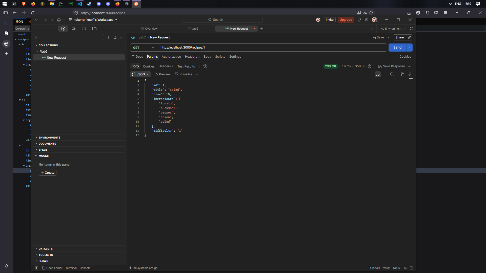
Отправил GET запрос на recipes/1/

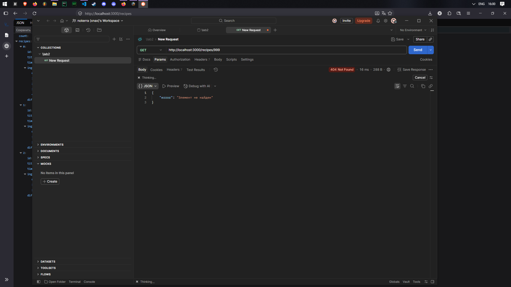
Отправил GET запрос на несуществующий адрес

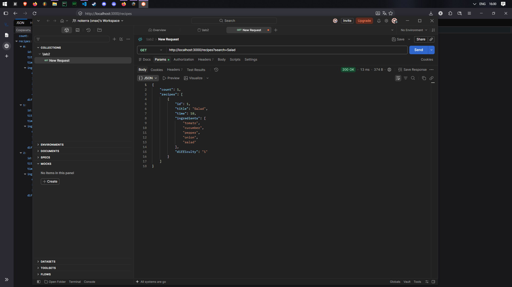
Осуществил поиск по названию

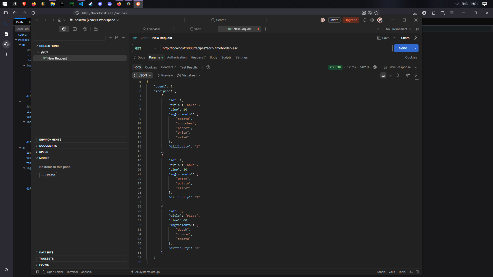
Отсортировал данные по времени по возрастанию

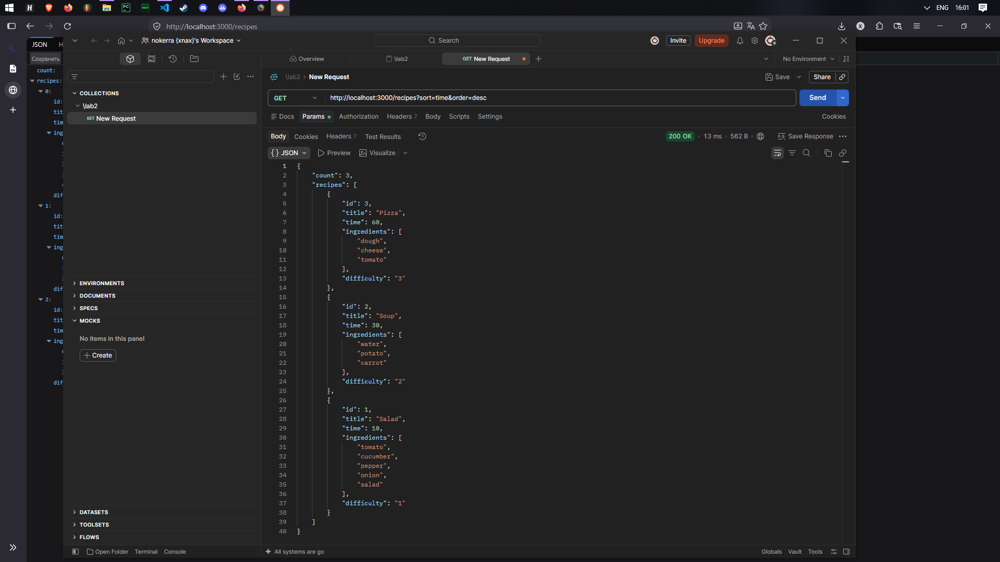
Отсортировал данные по времени по убыванию

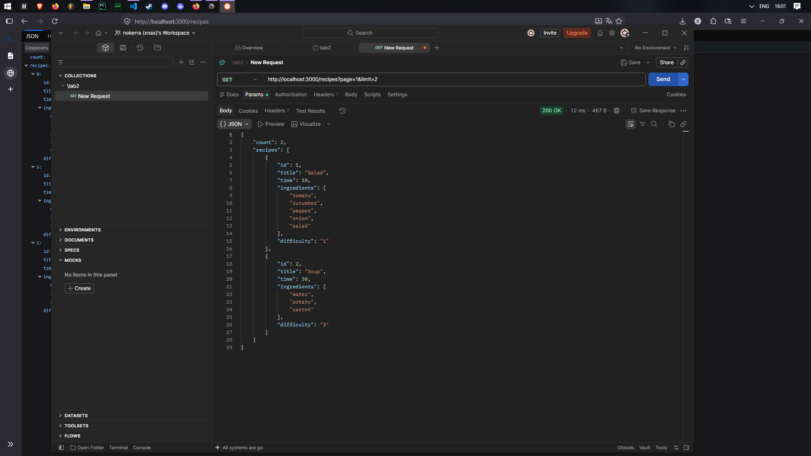
Осуществил пагинацию с лимитом в 2 элемента

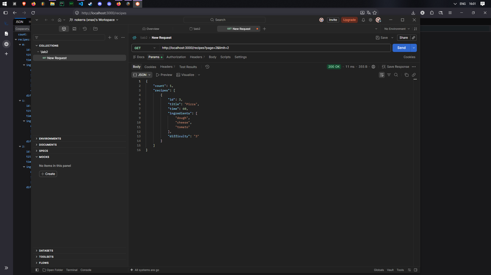
Вторая страница с оставшимися данными

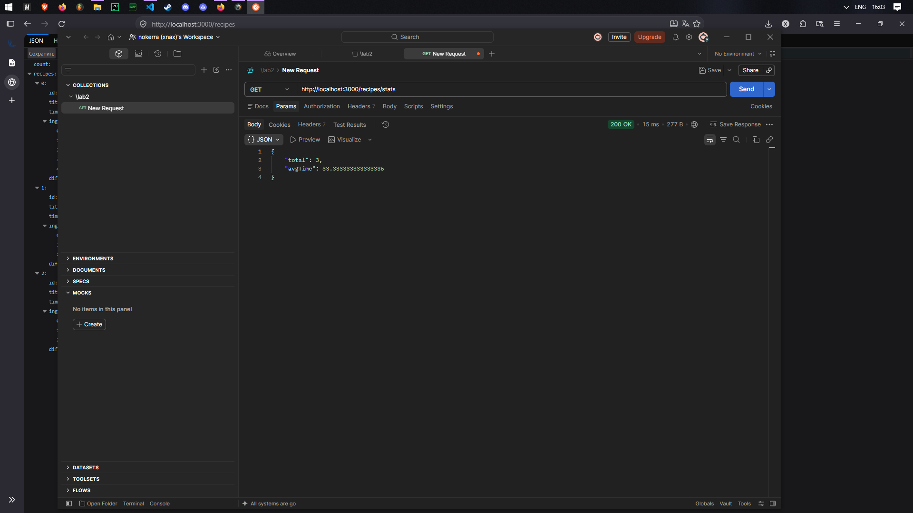
Сбор статистики с помощью stats

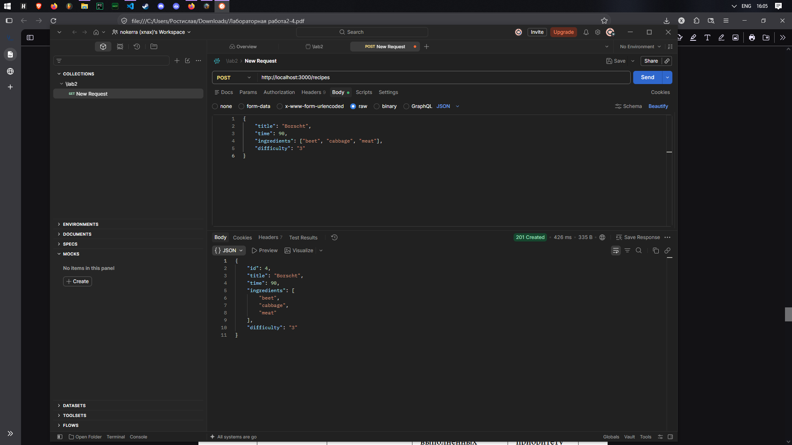
Добавил 1 элемент с помощью POST запроса на recipes/

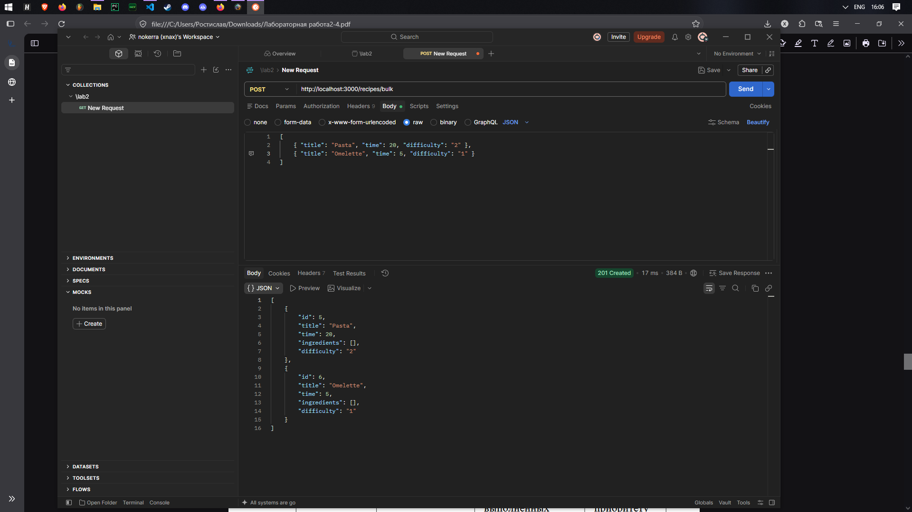
Добавил несколько элементов с помощью POST запроса на recipes/

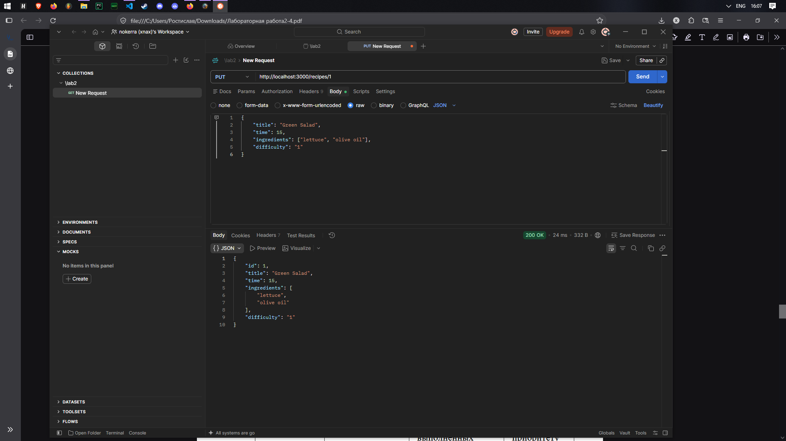
Обновил элемент с id 1 с помощью PUT запроса

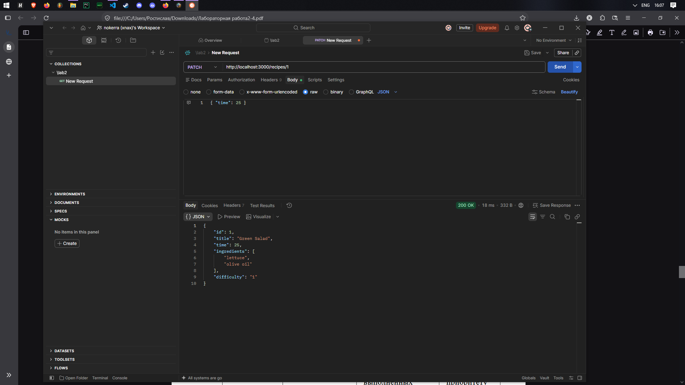
Обновил только одно поле time в элменте с id 1 с помощью PATCH запроса

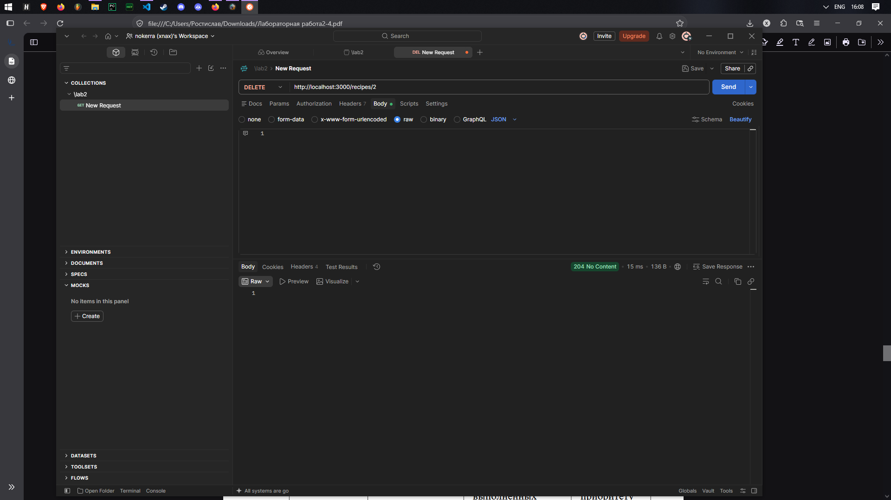
Удалил элемент с id 2 с помощью DELETE запроса

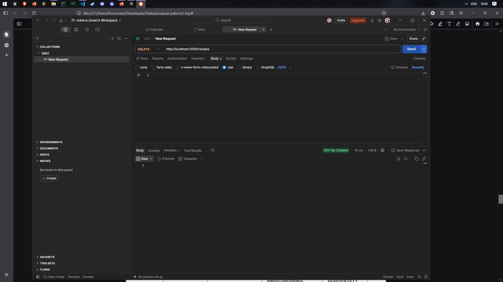
Удалил все элементы с помощью DELETE запроса

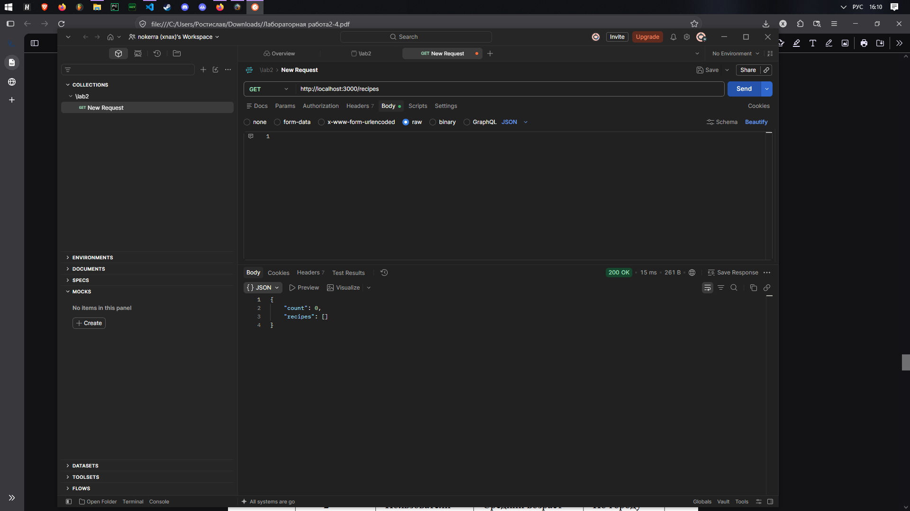
Отправил GET запрос на recipes/, чтобы убедиться, что все элементы были удалены

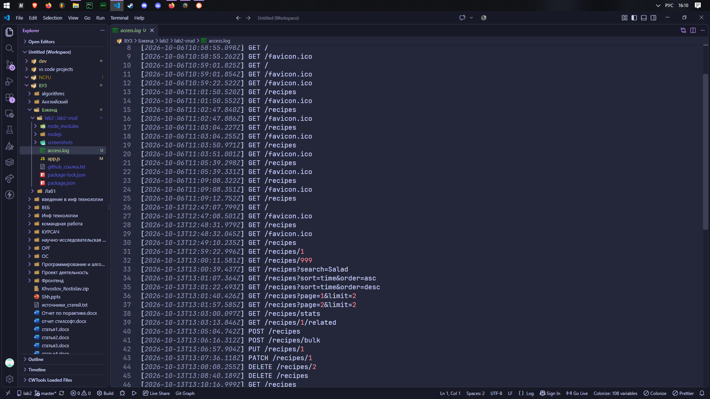
Логирование всех запросов в файл access.log

## Контрольные вопросы
**1. Как реализовать частичное обновление (PATCH)?**
Ответ: Найти запись по ID и обновить только те поля, которые присутствуют в `req.body`, а отсутствующие оставить без изменений.

**2. Как реализовать массовое удаление элементов?**
Ответ: Создать маршрут `DELETE /items` без параметра ID, очистить внутри массив или таблицу и вернуть статус 204.

**3. Как реализовать массовое создание элементов?**
Ответ: Принять массив объектов в маршруте `POST /items/bulk`, провалидировать каждый элемент, присвоить им уникальные ID и вернуть 201.

**4. Как реализовать глобальный обработчик ошибок?**
Ответ: Добавить в конец файла middleware с четырьмя аргументами `(err, req, res, next)`, который логирует ошибку и отправляет клиенту статус 500.

**5. Как логировать запросы в файл?**
Ответ: В middleware перед маршрутами записывать данные о запросе (метод, URL, дату) в файл через `fs.appendFile`.

**6. Что такое REST API и какие принципы лежат в его основе?**
Ответ: Архитектурный стиль для построения веб-сервисов, основанный на принципах клиент-серверной архитектуры, отсутствия состояния (stateless), кэшируемости и единообразия интерфейса (ресурсы и HTTP-методы).

**7. Как организовать структуру проекта для масштабируемого CRUD API?**
Ответ: Разделить код на папки по слоям (`routes`, `controllers`, `services`, `models`, `middlewares`), а в главном файле приложения только подключать их.

**8. Какие существуют стратегии генерации уникальных ID?**
Ответ: Автоинкремент, UUID/GUID, ULID/Snowflake, использование временных меток (timestamp), ObjectId в MongoDB или генерация на стороне базы данных.

**9. Как защитить API от слишком больших запросов?**
Ответ: Ограничить размер тела запроса через `express.json({ limit: '10kb' })`.

**10. Как реализовать связь между сущностями (например, задачи и пользователи)?**
Ответ: Хранить в объекте одной сущности идентификатор другой (например, `userId` в задаче) и создавать отдельный эндпоинт для получения связанных данных.

## Вывод
Освоили обработку различных HTTP-методов (GET, POST, PUT, DELETE) в Express/Flask. Научились реализовывать CRUD-операции над коллекцией объектов, хранящейся в памяти сервера, а также возвращать корректные HTTP-коды ответов (200, 201, 404).
