# Лабораторная работа №3: Маршрутизация, параметры пути и query-параметры

**Студент:** Хвостов Ростислав Романович

**Группа:** ПИЖ-б-о-25-2

## Цель работы
Освоить различные способы передачи данных через URL. Научиться строить гибкие маршруты с параметрами пути и query-параметрами, комбинировать их, обрабатывать вложенные ресурсы и валидировать входные данные. Понять разницу между req.params, req.query и req.body.

## Ход работы
Код работы:

```python
from flask import Flask, jsonify, request
from datetime import datetime

app = Flask(__name__)

recipes = [
    {"id": 1, "title": "Borsch", "time": 120, "difficulty": "medium", "chef_id": 1},
    {"id": 2, "title": "Olivie", "time": 60, "difficulty": "easy", "chef_id": 2},
    {"id": 3, "title": "Pelmeni", "time": 90, "difficulty": "medium", "chef_id": 1},
    {"id": 4, "title": "Befstroganof", "time": 45, "difficulty": "easy", "chef_id": 3},
    {"id": 5, "title": "Plov", "time": 150, "difficulty": "hard", "chef_id": 2},
    {"id": 6, "title": "Blini", "time": 30, "difficulty": "easy", "chef_id": 1},
    {"id": 7, "title": "Kharcho", "time": 100, "difficulty": "medium", "chef_id": 3},
]

chefs = [
    {"id": 1, "name": "Ivan Petrov", "speciality": "russian"},
    {"id": 2, "name": "Maria Sidorova", "speciality": "european"},
    {"id": 3, "name": "Alexey Kuznetsov", "speciality": "caucasian"},
]

difficulties = ["easy", "medium", "hard"]

@app.before_request
def log_request():
    ip = request.remote_addr
    print(f"[{datetime.now().strftime('%Y-%m-%d %H:%M:%S')}] "
          f"{request.method} {request.full_path} | IP: {ip}")

def find_recipe(recipe_id):
    return next((r for r in recipes if r["id"] == recipe_id), None)

def find_chef(chef_id):
    return next((c for c in chefs if c["id"] == chef_id), None)

def bad_request(msg):
    return jsonify({"error": msg}), 400

def not_found(msg):
    return jsonify({"error": msg}), 404


@app.route('/recipes')
def get_recipes():
    result = list(recipes)

    search = request.args.get('search')
    if search:
        result = [r for r in result if search.lower() in r["title"].lower()]

    filter_param = request.args.get('filter')
    if filter_param:
        if ':' not in filter_param:
            return bad_request("filter должен быть в формате field:value")
        field, value = filter_param.split(':', 1)
        allowed_filter = ['difficulty', 'time']
        if field not in allowed_filter:
            return bad_request(f"Поле фильтрации должно быть одним из: {allowed_filter}")
        if field == 'time':
            try:
                value_int = int(value)
            except ValueError:
                return bad_request("Значение time должно быть числом")
            result = [r for r in result if r[field] == value_int]
        else:
            result = [r for r in result if str(r[field]).lower() == value.lower()]

    sort = request.args.get('sort')
    order = request.args.get('order', 'asc')
    allowed_sort = ['id', 'title', 'time', 'difficulty']
    if sort:
        if sort not in allowed_sort:
            return bad_request(f"Поле сортировки должно быть одним из: {allowed_sort}")
        if order not in ['asc', 'desc']:
            return bad_request("Параметр order должен быть asc или desc")
        result.sort(key=lambda x: x[sort], reverse=(order == 'desc'))

    page = request.args.get('page', 1, type=int)
    limit = request.args.get('limit', 10, type=int)
    if page is None or page < 1:
        return bad_request("page должен быть >= 1")
    if limit is None or limit < 1 or limit > 100:
        return bad_request("limit должен быть от 1 до 100")

    total = len(result)
    start = (page - 1) * limit
    paginated = result[start:start + limit]
    total_pages = (total + limit - 1) // limit

    return jsonify({
        "count": total,
        "page": page,
        "limit": limit,
        "totalPages": total_pages,
        "items": paginated
    })


@app.route('/recipes/<int:recipe_id>')
def get_recipe(recipe_id):
    recipe = find_recipe(recipe_id)
    if not recipe:
        return not_found("Рецепт не найден")
    return jsonify(recipe)


@app.route('/recipes/<int:recipe_id>/chef')
def get_recipe_chef(recipe_id):
    recipe = find_recipe(recipe_id)
    if not recipe:
        return not_found("Рецепт не найден")
    chef = find_chef(recipe["chef_id"])
    return jsonify({"recipe": recipe["title"], "chef": chef})


@app.route('/chefs/<int:chef_id>/recipes')
def get_chef_recipes(chef_id):
    chef = find_chef(chef_id)
    if not chef:
        return not_found("Шеф не найден")
    chef_recipes = [r for r in recipes if r["chef_id"] == chef_id]
    return jsonify({"chef": chef["name"], "count": len(chef_recipes), "recipes": chef_recipes})

@app.route('/difficulties/<string:difficulty>/recipes')
def get_recipes_by_difficulty(difficulty):
    if difficulty.lower() not in [d.lower() for d in difficulties]:
        return bad_request(f"Сложность должна быть одной из: {difficulties}")
    filtered = [r for r in recipes if r["difficulty"].lower() == difficulty.lower()]
    return jsonify({"difficulty": difficulty, "count": len(filtered), "recipes": filtered})


@app.route('/difficulties/<string:difficulty>/recipes/<int:recipe_id>')
def get_recipe_in_difficulty(difficulty, recipe_id):
    if difficulty.lower() not in [d.lower() for d in difficulties]:
        return bad_request(f"Сложность должна быть одной из: {difficulties}")
    recipe = find_recipe(recipe_id)
    if not recipe:
        return not_found(f"Рецепт с ID={recipe_id} не найден")
    if recipe["difficulty"].lower() != difficulty.lower():
        return not_found(f"Рецепт с ID={recipe_id} не относится к сложности '{difficulty}'")
    return jsonify({"difficulty": difficulty, "recipe": recipe})


@app.route('/chefs/<int:chef_id>/recipes/<int:recipe_id>/steps/<int:step_id>')
def get_recipe_step(chef_id, recipe_id, step_id):
    chef = find_chef(chef_id)
    if not chef:
        return not_found("Шеф не найден")
    recipe = find_recipe(recipe_id)
    if not recipe or recipe["chef_id"] != chef_id:
        return not_found(f"Рецепт с ID={recipe_id} не найден у шефа {chef_id}")
    if step_id < 1:
        return bad_request("step_id должен быть положительным числом")
    # Имитация шагов
    total_steps = 5
    if step_id > total_steps:
        return not_found(f"Шаг {step_id} не найден (всего шагов: {total_steps})")
    return jsonify({
        "chef": chef["name"],
        "recipe": recipe["title"],
        "step": step_id,
        "total_steps": total_steps,
        "description": f"Шаг {step_id} приготовления '{recipe['title']}'"
    })


@app.route('/recipes/stats')
def get_stats():
    if not recipes:
        return jsonify({"count": 0, "message": "Нет данных"})
    times = [r["time"] for r in recipes]
    by_difficulty = {}
    for r in recipes:
        by_difficulty.setdefault(r["difficulty"], []).append(r["time"])
    grouped = {d: round(sum(t) / len(t), 1) for d, t in by_difficulty.items()}

    return jsonify({
        "count": len(recipes),
        "avg_time": round(sum(times) / len(times), 1),
        "min_time": min(times),
        "max_time": max(times),
        "avg_time_by_difficulty": grouped
    })

@app.errorhandler(404)
def handle_404(error):
    return jsonify({"error": "Маршрут не найден"}), 404


@app.errorhandler(500)
def handle_500(error):
    return jsonify({"error": "Внутренняя ошибка сервера"}), 500

@app.route('/', defaults={'path': ''})
@app.route('/<path:path>')
def catch_all(path):
    return jsonify({"error": f"Маршрут '/{path}' не найден"}), 404


if __name__ == '__main__':
    app.run(debug=True, port=5000)
```

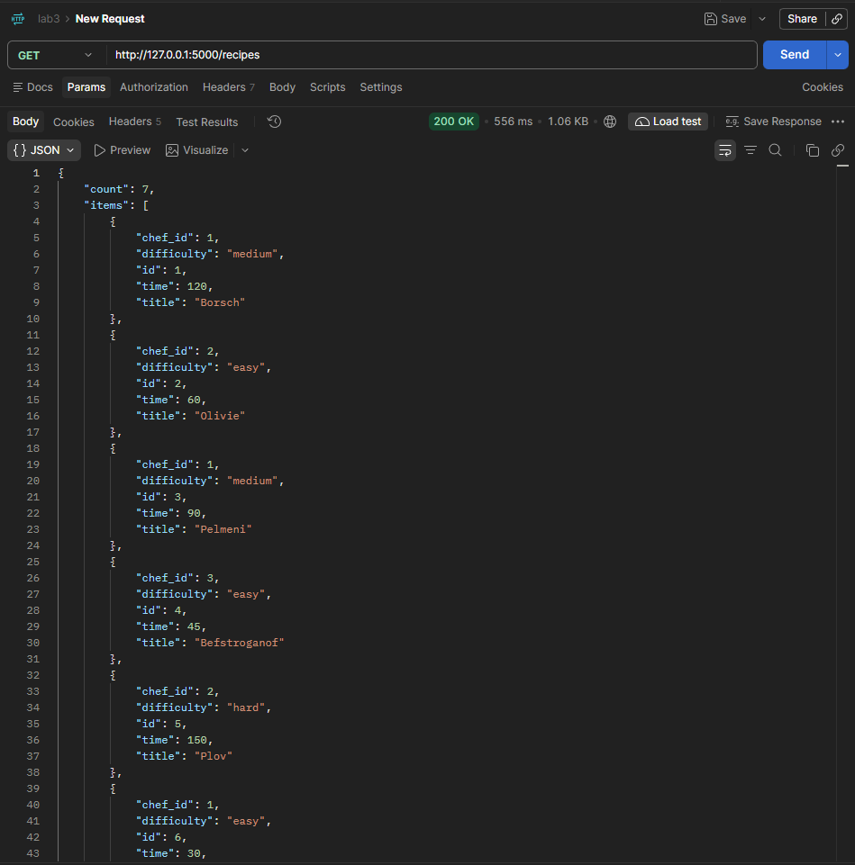

Получение всех рецептов

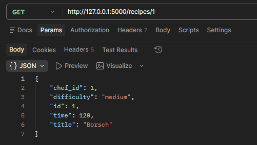

Получение рецепта по id

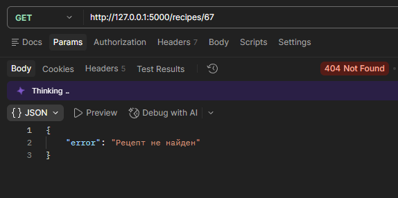

Обработка несуществующего id

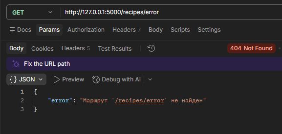

Обработка несуществующего маршрута

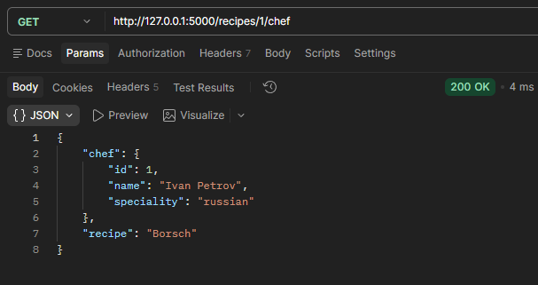

Получение шефа, связанного с рецептом

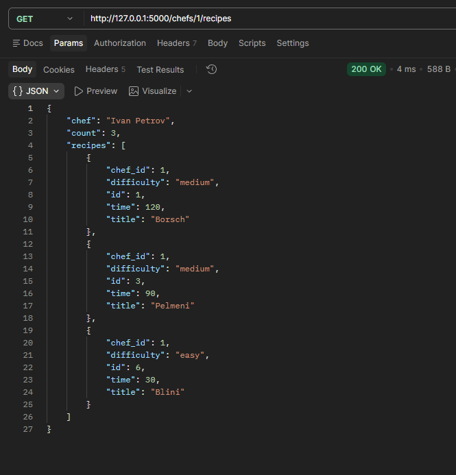

Получение всех рецептов, связанных с шефом

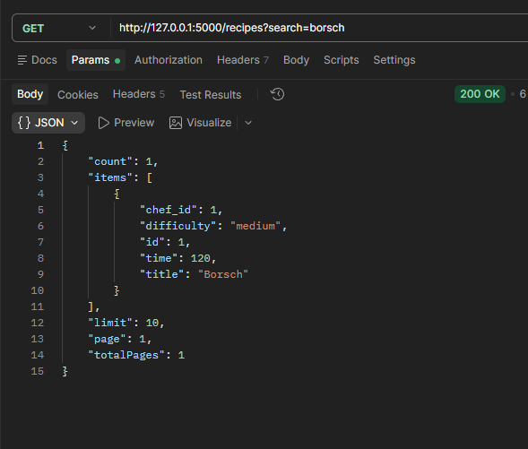

Поиск рецепта с помощью search

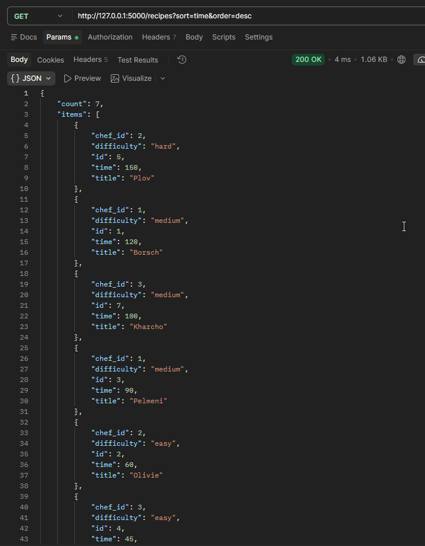

Получение рецептов, отсортированных по времени в обратном порядке

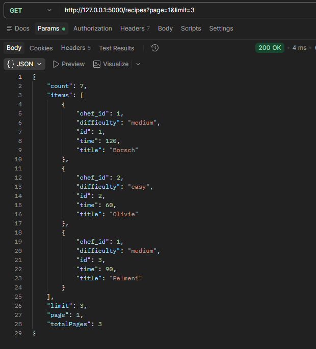

Реализвация пагинации с лимитом в 3 объекта на странице

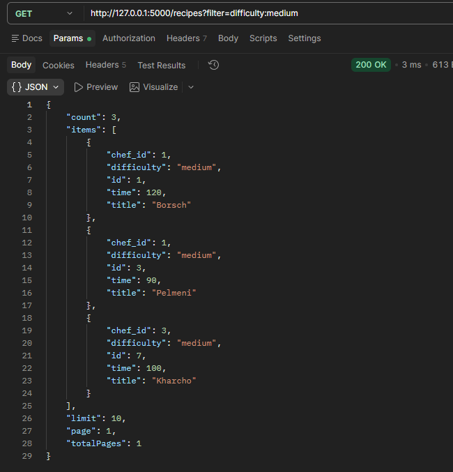

Получение отфильтрованных рецептов с помощью filter

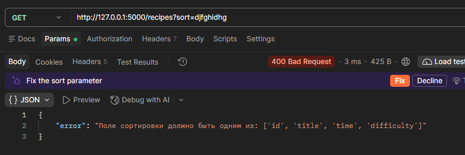

Обработка неверного параметра сортировки

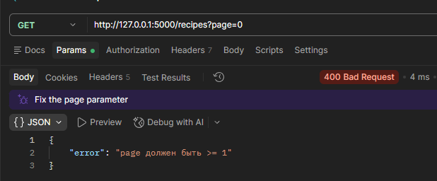

Обработка страницы, меньше 1

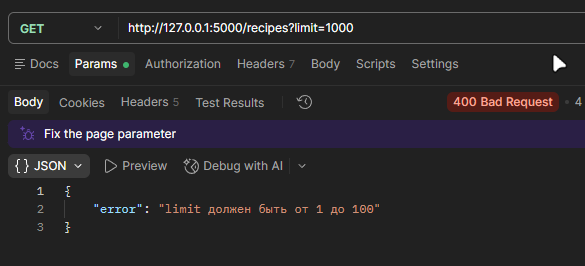

Обработка некорректного лимита объектов

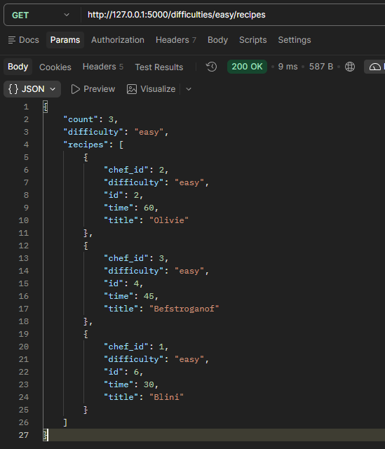

Получение всех рецептов сложности easy

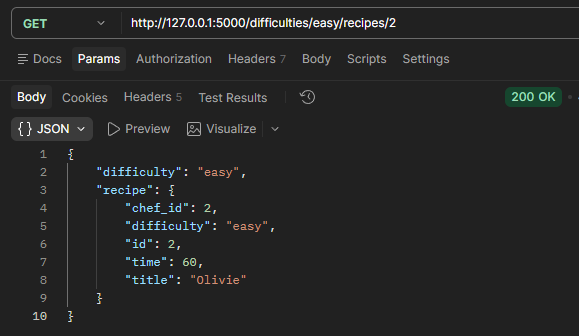

Получение рецепта сложности easy по id

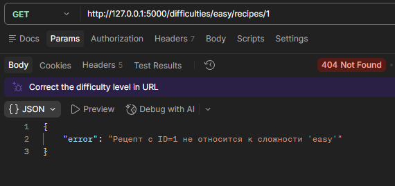

Обработка рецепта, id которого не относится к сложности

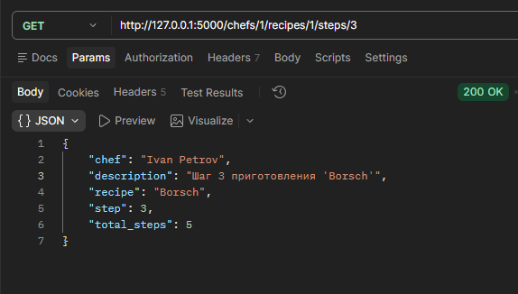

Получение шагов рецепта

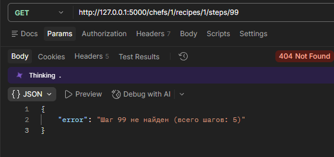

Обработка несуществующих шагов

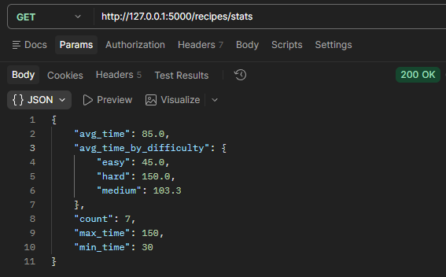

Получение статистики по рецептам

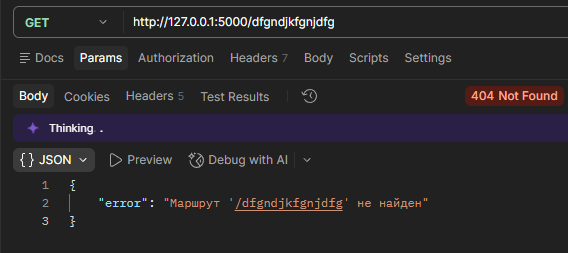

wildcard-маршрут для обработки несуществующих маршрутов

# Вывод

Освоили различные способы передачи данных через URL. Научились строить гибкие маршруты с параметрами пути и query-параметрами, комбинировать их, обрабатывать вложенные ресурсы и валидировать входные данные. Поняли разницу между req.params, req.query и req.body.

# Контрольные вопросы
20. Как комбинировать параметры пути и query-параметры в одном запросе?
Ответ: Указать параметр в пути маршрута, а query читать отдельно.

21. Как реализовать вложенные маршруты с несколькими уровнями?
Ответ: Задать путь с несколькими параметрами и проверять существование каждого уровня по цепочке.

22. Как обработать wildcard-маршрут и почему он должен быть последним?
Ответ: Объявить `@app.route('/<path:path>')`, который ловит все несовпавшие пути. Он должен быть последним, чтобы не перехватывать реальные маршруты.

23. Как реализовать глобальный обработчик ошибок?
Ответ: `@app.errorhandler(500)`, который возвращает JSON с ошибкой.

24. Как логировать все запросы с IP-адресом клиента?
Ответ: `@app.before_request` с выводом `request.remote_addr`, `request.method`, `request.full_path` и времени.

25. Как защитить API от слишком больших значений limit?
Ответ: Валидировать `limit` с верхней границей и возвращать 400 при превышении.

26. Как реализовать статистику по коллекции?
Ответ: Сделать отдельный эндпоинт `/recipes/stats`, который считает `count`, `avg`, `min`, `max` и группировку по полю.

27. Как организовать структуру проекта при росте числа маршрутов?
Ответ: Разбить код на модули, а app.py оставить только для создания приложения и регистрации.

28. Как документировать параметры маршрутов (OpenAPI/Swagger)?
Ответ: Использовать `flasgger` или `flask-smorest`, описывая эндпоинты и параметры в docstring и генерируя страницу `/apidocs` с интерактивной документацией.

29. Как тестировать маршруты с параметрами в Postman?
Ответ: Создать коллекцию с переменной `{{base_url}}`, добавить запросы на успешные и ошибочные сценарии (200/400/404), сохранять примеры ответов и запускать Collection Runner.
